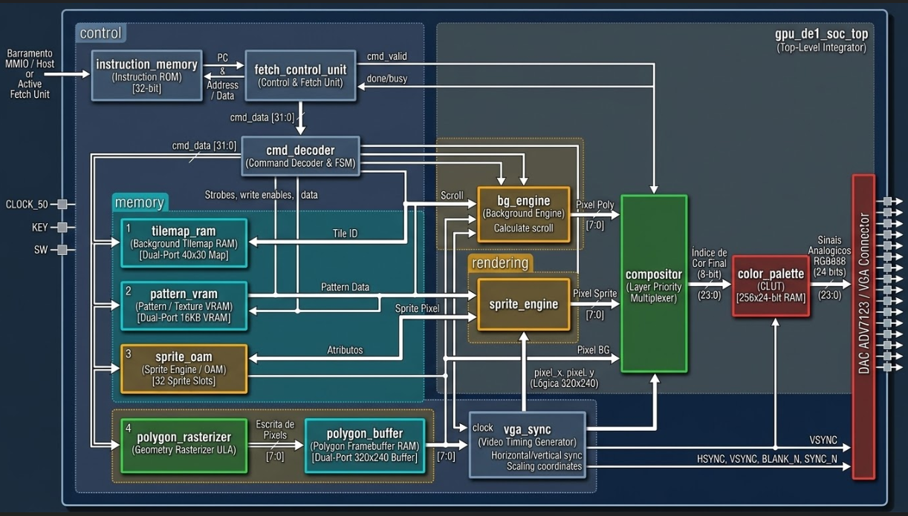

# Coprocessador com arquitetura própria utilizando a DE1-SoC - Desenvolvimento e projeção gráfica do Jogo Flappy Bird em Verilog.
  <h3>
    Lucca Coutinho, Mailson Alves, Ramon Santos
  
  </h3>


  <p>
    Engenharia de Computação – Universidade Estadual de Feira de Santana (UEFS)
    Av. Transnordestina, s/n, Novo Horizonte
    Feira de Santana – BA, Brasil – 44036-900
  </p>

---

## Sumário

1. [Definição do Problema](#1-definição-do-problema)
2. [Resumo da Solução Proposta](#2-resumo-da-solução-proposta)
3. [Requisitos do Sistema](#3-requisitos-do-sistema)
   - [3.1 Requisitos Funcionais](#31-requisitos-funcionais)
   - [3.2 Requisitos Não Funcionais](#32-requisitos-não-funcionais)
4. [Especificação do Hardware](#4-especificação-do-hardware)
5. [Arquitetura e Decisões de Projeto](#5-arquitetura-e-decisões-de-projeto)
   - [5.1 Visão Geral dos Módulos](#51-visão-geral-dos-módulos)
   - [5.2 Diagrama em Blocos](#52-diagrama-em-blocos)
   - [5.3 Conjunto de Instruções Customizado (ISA de 32 bits)](#53-conjunto-de-instruções-customizado-isa-de-32-bits)
   - [5.4 Justificativa das Decisões Adotadas](#54-justificativa-das-decisões-adotadas)
6. [Metodologia de Testes e Validação](#6-metodologia-de-testes-e-validação)
   - [6.1 Simulação em ModelSim e Testes Manuais](#61-simulação-em-modelsim-e-testes-manuais)
   - [6.2 Validação Visual da Saída VGA (Verilator)](#62-validação-visual-da-saída-vga-verilator)
7. [Apresentação dos Resultados](#7-apresentação-dos-resultados)
   - [7.1 Resultados de Simulação](#71-resultados-de-simulação)
   - [7.2 Demonstração em Hardware](#72-demonstração-em-hardware)
8. [Limitações, Gargalos e Itens Não Atendidos](#8-limitações-gargalos-e-itens-não-atendidos)
9. [Conclusão](#9-conclusão)
10. [Referências](#10-referências)

---

## 1. Definição do Problema

O projeto consiste na evolução de blocos gráficos individuais em Verilog HDL para um **coprocessador gráfico 2D (GPU) programável e 100% autônomo** na FPGA Cyclone V (kit DE1-SoC). Em vez de depender de estímulos manuais externos via chaves físicas, o circuito deve operar sob a organização clássica de um processador dedicado: buscar instruções de 32 bits em uma memória interna através de um ciclo de **Busca Ativa** (*Fetch-Decode-Execute*)[cite: 3, 12, 13], controlar o fluxo de execução via *handshake* e sincronismo vertical, e renderizar múltiplos planos visuais em tempo real no padrão VGA (640×480 @ 60 Hz).


## 2. Resumo da Solução Proposta


A solução desenvolvida implementa um coprocessador gráfico autônomo capaz de executar uma aplicação visual inspirada no jogo *Flappy Bird* diretamente a partir de uma memória de programa interna (`program.hex`). A arquitetura integra uma **Unidade de Busca e Controle** (`fetch_control_unit.v`) equipada com um Contador de Programa (*Program Counter* - PC) de 11 bits e um Registrador de Instrução (IR), que lê continuamente as palavras da **Memória de Instruções** (`instruction_memory.v`) alocada em blocos M10K. As instruções decodificadas atualizam dinamicamente o deslocamento (*scrolling*) do plano de fundo em *Tilemap* e as coordenadas dos *sprites* quadro a quadro, sincronizando as transições com o intervalo de apagamento vertical (`WAIT_VBLANK`) e mantendo a animação em laço contínuo (`JUMP`), restando apenas o botão físico `KEY[0]` para *Reset* global do sistema.


### 3.1 Requisitos Funcionais
---
* **RF01 - Busca Ativa e Controle de Fluxo:** Buscar instruções autonomamente em memória interna (`.hex`) utilizando um *Program Counter* (PC) de 11 bits, Registrador de Instrução (IR) e suporte a desvios incondicionais (`JUMP`).
* **RF02 - Protocolo de Handshake e Sincronismo de Quadro:** Pausar o avanço do PC durante operações de múltiplos ciclos da ULA gráfica (`rast_busy`) e aguardar o intervalo de apagamento vertical (`WAIT_VBLANK`) para evitar *screen tearing*.
* **RF03 - Decodificação de Instruções de 32 bits (ISA):** Decodificar e rotear palavras de comando em ciclo único baseadas em *Opcode* de 4 bits, *Sub-Op/ID* e *Payloads* de dados.
* **RF04 - Temporização VGA:** Gerar sinais `HSYNC`, `VSYNC` e controle de área ativa `BLANK_N` para o padrão 640×480 a 60 Hz.
* **RF05 - Motores de Background e Sprites:** Mapear matriz de 40×30 blocos de 8×8 pixels com suporte a registradores de *scroll* contínuo e processar objetos móveis de 16×16 pixels via memória de atributos (OAM).
* **RF06 - Rasterizador de Polígonos:** Calcular o preenchimento de primitivas geométricas e limpeza de *buffer* através de ULA aritmética dedicada.
* **RF07 - Composição e Paleta CLUT:** Multiplexar camadas respeitando a transparência fixa no índice `0x00` e converter índices de 8 bits para o padrão RGB888 (24 bits).

### 3.2 Requisitos Não Funcionais
* **RNF01 - Autonomia de Execução:** Operar de forma independente após o *reset* (`KEY[0]`), dispensando chaves seletoras manuais ou processador externo para injeção de comandos.
* **RNF02 - Estabilidade Temporal:** Manter sincronismo contínuo de varredura VGA a 25 MHz sem congelamentos do feixe analógico durante a busca e execução de instruções.
* **RNF03 - Eficiência de Memória em Blocos M10K:** Utilizar resolução lógica interna de 320×240 pixels (*upscaling* físico 2×2) e alocar tanto as VRAMs gráficas quanto a ROM de instruções (`2048 × 32 bits`) diretamente em blocos SRAM M10K da FPGA.
* **RNF04 - Determinismo em Hardware:** Eliminar divisores e multiplicadores combinacionais pesados nas rotinas de varredura e endereçamento de memória.

---
## 4. Especificação do Hardware

* **Placa de Testes:** Terasic DE1-SoC (FPGA Intel Cyclone V SoC `5CSEMA5F31C6N`).
* **Conversor Digital-Analógico (DAC):** ADV7123 (Triplo DAC de vídeo RGB888).
* **Interface de Saída:** Conector analógico padrão VGA DB15.
* **Clock de Entrada:** Oscilador base de 50 MHz da placa (gerando clock interno de pixel de 25 MHz).

---

## 5. Arquitetura e Decisões de Projeto

### 5.1 Visão Geral dos Novos Módulos (Núcleo de Busca Ativa)

Para atender aos requisitos do Problema 2, o antigo controlador de entradas manuais (`board_input_controller.v`) foi removido e substituído pelos módulos que formam o núcleo de busca e controle do coprocessador:

* **`instruction_memory.v` (Memória ROM de Programa):** Módulo de memória interna parametrizado para suportar até **2048 palavras de 32 bits** (endereçamento de 11 bits)[cite: 3]. É sintetizado diretamente nos blocos dedicados M10K da FPGA (`ramstyle = "M10K"`) e inicializado autonomamente no *boot* com o código binário do arquivo `program.hex` via diretiva `$readmemh`, garantindo o isolamento entre memória de código e memória de padrões visuais (`tiles.hex`).
* **`fetch_control_unit.v` (Unidade de Busca e Controle):** Cérebro do ciclo *Fetch-Decode-Execute*[cite: 3, 6]. Abriga o **Program Counter (PC) de 11 bits** (`pc[10:0]`), o **Registrador de Instrução (IR)** implementado no barramento de saída registrada (`cmd_data[31:0]`) e uma Máquina de Estados Finitos (FSM) dividida em três estados principais (`S_FETCH`, `S_EXEC` e `S_VBLANK`). Gerencia o disparo do pulso `cmd_valid` para o decodificador, monitora os sinais de *handshake* (`cmd_ready` e `rast_busy`), intercepta instruções de sincronismo vertical (`0xE - WAIT_VBLANK`) e executa desvios incondicionais (`0xF - JUMP`).
* **`cmd_decoder.v` (Decodificador Atualizado):** Integrado diretamente à saída da Unidade de Busca, decodifica os 32 bits vindos do IR em ciclo único, gerando *strobes* de escrita para a paleta, *Tilemap* e OAM de *sprites*, além de incorporar suporte ao incremento autônomo de rolagem horizontal (`0xA - INC_SCROLL_X`) e retenção de vértices para a ULA geométrica.

### 5.2 Diagrama do projeto (GPU e )

<!-- ESPAÇO PARA O DIAGRAMA ARQUITETURAL -->
> **Figura 1: Diagrama Estrutural do Coprocessador Gráfico**
> 
> ```
>        [ Instrução 32-bit (cmd_data) ]
>                       │
>                       ▼
>            ┌─────────────────────┐
>            │ cmd_decoder (FSM)   │
>            └──────────┬──────────┘
>                       │
>         ┌─────────────┼─────────────┬─────────────┐
>         ▼             ▼             ▼             ▼
>   ┌───────────┐ ┌───────────┐ ┌───────────┐ ┌───────────┐
>   │  Pattern  │ │  Tilemap  │ │  Sprite   │ │Polygon    │
>   │   VRAM    │ │   VRAM    │ │   OAM     │ │Rasterizer │
>   └─────┬─────┘ └─────┬─────┘ └─────┬─────┘ └─────┬─────┘
>         │             │             │             │
>         └──────┬──────┘             │             ▼
>                │                    │       ┌───────────┐
>                ▼                    │       │  Polygon  │
>         ┌─────────────┐             │       │  Buffer   │
>         │  bg_engine  │             │       └─────┬─────┘
>         └──────┬──────┘             │ (Pixel SP)  │ (Pixel Poly)
>                │ (Pixel BG)         │             │
>                └────────────┬───────┴─────────────┘
>                             ▼
>                     ┌───────────────┐     ┌──────────────┐
>                     │  compositor   │ ◄───┤   vga_sync   │
>                     └───────┬───────┘     └──────────────┘
>                             │ (Índice 8-bit)
>                             ▼
>                     ┌───────────────┐
>                     │ color_palette │
>                     └───────┬───────┘
>                             │ (RGB 24-bit)
>                             ▼
>                      [ DAC ADV7123 ] ──► Conector VGA
> ```
> *(Diagrama sequencial dos módulos do projeto)*



 *(Diagrama de alto nível do projeto com os módulos implementados)*
 
### 5.3 Conjunto de Instruções Customizado 

Formato: `[31:28]` Opcode | `[27:24]` Sub-Op / ID | `[23:0]` Payloads

| Opcode | Mnemônico | Formato dos Bits [27:0] | Descrição |
| :--- | :--- | :--- | :--- |
| `0x0` | `CLEAR_SCREEN` | `[27:24]=0xF`, `[23:0]=0` | Limpa o Framebuffer com cor nula. |
| `0x1` | `SET_PALETTE` | `[23:16]=Addr`, `[15:0]=RGB565` | Carrega cor na tabela de paleta. |
| `0x3` | `WRITE_TILEMAP` | `[27:22]=X`, `[21:17]=Y`, `[16:9]=TileID` | Escreve uma célula no mapa de fundo. |
| `0x5` | `SET_SCROLL` | `[16:8]=Scroll_X`, `[7:0]=Scroll_Y` | Ajusta o deslocamento do fundo. |
| `0x6` | `SET_SPRITE_POS` | `[27:23]=ID`, `[22:14]=X`, `[13:6]=Y` | Define posição lógica de um sprite. |
| `0x7` | `DRAW_TRI_V1` | `[20:12]=X0`, `[7:0]=Y0` | Grava vértice $V_0$ do triângulo. |
| `0x8` | `DRAW_TRI_V2` | `[20:12]=X1`, `[7:0]=Y1` | Grava vértice $V_1$ do triângulo. |
| `0x9` | `DRAW_TRI_V3` | `[27:20]=Cor`, `[19:11]=X2`, `[7:0]=Y2` | Grava vértice $V_2$ e dispara a ULA. |
| `0xB` | `SET_SPRITE_ATTR`| `[27:23]=ID`, `[22:15]=TileID`, `[14:9]=Flags` | Configura atributos do sprite. |

### 5.4 Justificativa das Decisões Adotadas

* **Adoção da Busca Ativa em Hardware Puro (vs. Busca Passiva via HPS):**  
  Optou-se pela implementação da **Busca Ativa** contida 100% na lógica da FPGA em vez da busca passiva via barramento ARM HPS/Avalon-MM[cite: 5]. Essa decisão eliminou a dependência de pontes complexas no *Platform Designer (Qsys)*, filas FIFO assíncronas entre múltiplos domínios de clock e drivers em C no Linux[cite: 5], permitindo acoplar o par `{cmd_data, cmd_valid}` diretamente ao decodificador com risco zero de travamento de barramento (*bus stall*) e mantendo o circuito determinístico[cite: 5].

* **Program Counter (PC) de 11 Bits (`2048` Instruções):**  
  Como a animação em busca ativa pura descreve a movimentação quadro a quadro ("desenrolando" os frames de rolagem e posição dos objetos na memória ROM)[cite: 3, 9], um PC de 8 bits (256 linhas) sofria transbordo (*overflow*) prematuro em sequências longas[cite: 3]. A expansão do PC para **11 bits (`[10:0]`)** permitiu endereçar até **2048 palavras de 32 bits** no arquivo `program.hex`, viabilizando animações contínuas e suaves consumindo uma fração mínima dos blocos M10K disponíveis na Cyclone V[cite: 3].

* **Sincronismo de Quadro por Hardware (`WAIT_VBLANK` — Opcode `0xE`):**  
  Para evitar que o processador atualizasse coordenadas de *sprites* e *scroll* na velocidade de clock de 25/50 MHz (o que tornaria o movimento invisível ao olho humano e causaria rasgos na imagem / *screen tearing*), implementou-se a instrução dedicada `WAIT_VBLANK`[cite: 3, 6]. Ao decodificar o Opcode `0xE`, a FSM da unidade de busca pausa o avanço do PC no estado `S_VBLANK` até detectar a borda de descida do sinal `VSYNC`, travando a taxa de atualização lógica em exatos 60 FPS.

* **Protocolo de Handshake (`cmd_valid`, `cmd_ready` e `rast_busy`):**  
  O coprocessador lida com instruções de latências assimétricas: escritas em registradores levam 1 ciclo de clock, enquanto rotinas de preenchimento na ULA demandam milhares de ciclos[cite: 3, 9]. O congelamento do PC condicionado a `cmd_ready && !rast_busy` garante que nenhuma instrução subsequente atropele uma operação em andamento.

* **Formato da Palavra de Instrução de 32 bits (Domain-Specific ISA):**  
  A largura fixa de 32 bits (`[31:28]` Opcode, `[27:23]` Sub-Op/ID e `[22:0]` Payloads) permite buscar uma instrução completa em um único acesso à Block RAM e decodificá-la paralelamente sem múltiplos ciclos de busca[cite: 2, 3]. Para primitivas que excedem 32 bits (como os 3 vértices de um triângulo), utilizam-se *Hold Registers* nas instruções `0x7` e `0x8` antes do disparo na instrução `0x9`.

* **Downscaling Lógico para 320×240 e Endereçamento sem Multiplicadores:**  
  A renderização interna em 320×240 (com *upscaling* físico 2×2 via descarte do LSB dos contadores VGA) reduz em 75% o consumo de memória SRAM interna. Adicionalmente, o cálculo linear `Addr = Y * 320 + X` foi implementado via deslocamentos e somadores combinacionais `(Y << 8) + (Y << 6) + X`, poupando blocos DSP da FPGA.

## 6. Metodologia de Testes e Validação

### 6.1 Simulação do circuito e Testes Manuais
A validação e os testes realizados para verificar a sequência de instruções e operações realizadas foram feitas através de recursos da plana como botões e chaves.
Para simular uma entrada de comando 
* **Validação dos Sinais de Sincronismo:** Foram simuladas as contagens horizontais (0 a 799) e verticais (0 a 524) no `vga_sync`, comprovando a largura e polaridade dos pulsos de `HSYNC`, `VSYNC` e intervalos de *Blanking* em conformidade com o padrão VESA.
* **Testes Manuais do Decodificador:** Foram elaborados testbenches com injeção sequencial de palavras de 32 bits para verificar a extração de parâmetros dos opcodes (como `WRITE_TILEMAP`, `SET_SCROLL` e montagem de vértices geométricos), acompanhando a transição correta dos registradores de retenção (*hold registers*).
* **Composição de Camadas e Prioridade:** Vetores de teste com pixels simultâneos no fundo, sprites e polígonos validaram que o índice `0x00` mantém transparência e que elementos geométricos e sprites sobrepõem o cenário corretamente.

### 6.2 Validação Visual da Saída VGA (Verilator)
Para complementar os testes em formas de onda, foi utilizada uma rotina auxiliar de co-simulação baseada em **Verilator**. O módulo sintetizado foi compilado diretamente para ambiente C++, permitindo amostrar os sinais de saída analógica `VGA_R`, `VGA_G`, `VGA_B`, `HSYNC` e `VSYNC` ciclo a ciclo e reconstruir o quadro de vídeo visualmente antes da programação na placa de desenvolvimento[cite: 3].

---

## 7. Apresentação dos Resultados

### 7.1 Resultados de Simulação
O armazenamento dos elementos gráficos foi estruturado dividindo as matrizes visuais da lógica de posicionamento. Os padrões gráficos de $8\times8$ pixels para o cenário e os blocos de $16\times16$ pixels dos sprites foram desenhados em imagens indexadas de 8 bits e convertidos para o arquivo tiles.hex (ou sprites_data.hex), o qual é carregado na memória de padrões pattern_vram.v durante a síntese por meio da diretiva $readmemh. Em paralelo, o mapa de fundo é definido no arquivo tilemap_data.hex (ou tilemap_init.hex), contendo uma grade de $40\times30$ posições com os identificadores dos blocos (Tile IDs) inicializados na tilemap_ram.v. Durante a varredura VGA, o módulo bg_engine.v consulta a matriz de blocos e indexa a pattern_vram.v em tempo real (on-the-fly), enquanto os atributos dinâmicos dos objetos móveis (como coordenadas $X,Y$ e identificador do padrão) são gerenciados na tabela de controle da memória OAM (sprite_oam.v).
As simulações confirmaram a estabilidade do sincronismo e o correto acionamento dos módulos de renderização sob recepção de comandos de 32 bits. 

A mecânica do jogo já pôde ser implementada e a simulação do comando para ativar a sprite principal do jogo foi adaptada na placa. Dessa forma, foi possível simular a movimentação e renderização em tempo real mesmo sendo em nível de hardware.

### 7.2 Demonstração em Hardware
O circuito foi sintetizado no Intel Quartus Prime e a imagem gerada manteve sincronismo estável a 60 Hz, suficiente para visualização da movimentação das sprites e do background.
Os push buttons da placa foram utilizados com a finalidade de testar o funcionamento do circuito. O botão KEY1 é responsável pelo pulo do personagem, enquanto os botões KEY2 e KEY3 desenham um triângulo e um retângulo no centro da tela, respectivamente, para demonstrar o funcionamento do rasterizador de polígonos. Também há o botão KEY0, utilizado para representar um "reset" no jogo, preparando-o para a próxima etapa do produto.

<!-- ESPAÇO PARA FOTOS DO CIRCUITO FÍSICO -->
Imagem Exibida no Monitor VGA 

 

  *Figura 1: Saída gráfica estável no monitor externo.* 


---


## Novos Módulos Implementados para o Problema 2 (Busca Ativa)

Para evoluir a arquitetura desenvolvida anteriormente em um coprocessador gráfico 2D programável e 100% autônomo[cite: 2, 5, 8], o antigo controlador de disparo manual por chaves da placa (`board_input_controller.v`) foi substituído por um núcleo clássico de busca e controle de execução[cite: 2, 8, 10, 11]. Os motores gráficos passaram a atuar exclusivamente como unidades funcionais subordinadas ao ciclo de busca (*Fetch-Decode-Execute*)[cite: 2, 5, 10, 11].

### 1. Memória de Instruções (`instruction_memory.v`)
* **Armazenamento em Block RAM (M10K):** Módulo responsável por armazenar o código executável do programa gráfico[cite: 2, 5, 8]. Foi sintetizado diretamente nos blocos de memória interna M10K da FPGA Cyclone V (via diretiva `ramstyle = "M10K"`)[cite: 2, 10, 11].
* **Inicialização Autônoma (`program.hex`):** Carrega as palavras de instrução de 32 bits durante a síntese/inicialização por meio da diretiva `$readmemh("program.hex", memory)`[cite: 2, 10, 11], mantendo a separação arquitetural entre memória de código (`program.hex`) e memória de dados visuais (`tiles.hex` / `pattern_vram.v`)[cite: 1, 2, 11].

### 2. Unidade de Busca e Controle (`fetch_control_unit.v`)
* **Contador de Programa (PC) e Registrador de Instrução (IR):** Gerencia o ponteiro de endereço atual (`PC`) que indexa a memória de instruções e armazena a palavra lida no registrador de instrução (`IR`), garantindo a estabilidade dos sinais no barramento `cmd_data` durante a decodificação[cite: 2, 8, 10].
* **Protocolo de Handshake e Controle de Fluxo:** Orquestra o avanço do `PC` de acordo com a latência de cada operação[cite: 2, 8, 10]:
  * **Instruções de Ciclo Único:** Comandos imediatos de configuração (como `SET_PALETTE`, `WRITE_TILEMAP`, `SET_SCROLL` e atributos de sprites) emitem o pulso `cmd_valid` e incrementam o ponteiro sequencialmente (`PC <= PC + 1`)[cite: 8, 10].
  * **Controle de Busy (Espera pela ULA):** Ao despachar instruções de múltiplas iterações para o rasterizador (`CLEAR_SCREEN` ou disparo de polígonos), a unidade monitora o sinal `rast_busy` e congela o avanço do `PC` até a conclusão completa do preenchimento em memória[cite: 2, 8, 10].
  * **Sincronização de Quadro (`WAIT_VBLANK` - Opcode `0xE`):** Pausa a execução do programa até a detecção do intervalo de apagamento vertical (`vsync`/`vblank`), permitindo atualizar posições de sprites e rolagem de cenário sem causar artefatos visuais (*screen tearing*)[cite: 2, 8, 10].
  * **Saltos e Loops (`JUMP / HALT` - Opcode `0xF`):** Permite alterar o valor do `PC` para um endereço específico de retorno, viabilizando laços contínuos de animação e dinâmica de jogo de forma autônoma, mantendo apenas o botão físico `KEY[0]` como sinal global de *Reset*[cite: 1, 8, 10, 11, 13].

---

## 8. Limitações, Gargalos e Itens Não Atendidos

Com base no escopo e no ciclo de desenvolvimento, sintetizam-se as funcionalidades que não foram integralmente concluídas:

* **Espelhamento de sprites (*Flip H / Flip V*):** A lógica de inversão de leitura interna dos eixos de coordenadas nos blocos de sprites não foi concluída no circuito de varredura.
* **Salvamento das 32 sprites em memória:** A estrutura de armazenamento e o gerenciamento para o conjunto total dos 32 slots de sprites não foram totalmente integrados à rotina de renderização dinâmica em tempo real.
* **Mudança da paleta de cores das sprites:** A seleção e comutação dinâmica de sub-paletas de cores para instâncias específicas de sprites não foram conectadas ao estágio de composição final.
* **Generalização do rasterizador de polígonos:** O módulo de rasterização atual foi validado para geometrias e primitivas de teste pré-estabelecidas, não possuindo capacidade de renderizar qualquer triângulo ou retângulo arbitrário proposto em tempo de execução.


Com base na implementação final do sistema e nos testes realizados em hardware e simulação, o único ponto pendente em relação à exibição visual foi:

* **Exibição em tela da rasterização de polígonos:** Embora a lógica da máquina de estados (FSM), a ULA de funções de aresta (`polygon_rasterizer.v`) e o buffer dedicado (`polygon_buffer.v`) tenham sido implementados e integrados ao decodificador de instruções[cite: 1, 2, 3, 12], não foi possível exibir a renderização visual dos polígonos diretamente na tela/monitor VGA durante a demonstração final.
---

## 9. Conclusão

O projeto atendeu aos objetivos centrais de implementação de um coprocessador gráfico dedicado em FPGA. A integração entre os geradores de sincronismo VGA, o decodificador de palavras de 32 bits, o motor de plano de fundo em *Tilemap* e o compositor de camadas com paleta CLUT permitiu a geração estável de sinal de vídeo analógico[cite: 1, 2, 7]. A metodologia apoiada em simulações manuais no ModelSim e validações complementares assegurou a consistência do circuito antes da síntese e validação física na placa de testes.

---

## 10. Referências

1. INTEL. *Cyclone V Device Handbook: Volume 1: Device Interfaces and Integration*, 2020.
2. TERASIC. *DE1-SoC User Manual*, Terasic Technologies Inc., Rev. F, 2019.
3. PINEDA, Juan. *A Parallel Approach to Polygon Rasterization*. In: ACM SIGGRAPH Computer Graphics, 1988.
4. VESA. *VESA and Industry Standards and Guidelines for Computer Display Monitor Timing (DMT)*, Version 1.0, Rev. 0.8, 1998.
